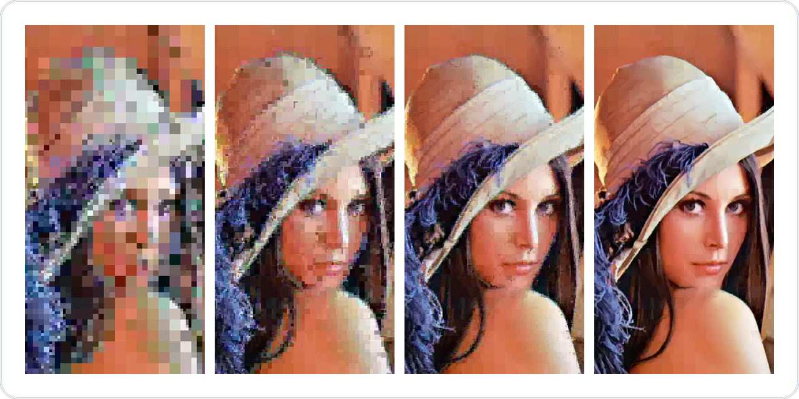

<h1 align="center">Mars</h1>

<p align="center">A quadtree fractal image codec in Rust, for Apple Silicon.</p>

<p align="center">
  <a href="docs/example.md"><b>Example</b></a> &nbsp;·&nbsp;
  <a href="#quick-start">Quick start</a> &nbsp;·&nbsp;
  <a href="#documents">Documents</a> &nbsp;·&nbsp;
  <a href="#how-it-works">How it works</a>
</p>

<p align="center">
  
</p>

Mars stores an image as a set of self-similarities, then rebuilds it by iteration,
as above. It is a clean-room Rust rewrite of Mario Polvere's 1998 C codec,
targeting aarch64 and Metal, with rate–distortion partitioning, colour,
progressive streams, nine search methods, and every result measured against the
original. A 512×512 colour image encodes to 15,234 bytes (0.465 bpp) at 29.87 dB
PSNR-Y; see the [example](docs/example.md).

## Quick start

```bash
cargo build --release -p mars-cli
./target/release/encmars lena.jpg lena.mars     # 15,234 bytes, 0.465 bpp
./target/release/decmars lena.mars decoded.png
just                                            # list the tasks: tests, gates, benchmarks
```

`--lambda 50` favours quality and `--lambda 800` smaller files. See
[Encoding and decoding](docs/usage.md) for the options and formats.

## Documents

| Document | What's in it |
| -------- | ------------ |
| [Example](docs/example.md) | An encode at 0.465 bpp, its quality, and the progressive decode |
| [Encoding and decoding](docs/usage.md) | `encmars` and `decmars`: options, input and output formats, progressive streams |
| [Measurement and experiments](docs/experiments.md) | Setting up the measurements, and the research experiment runner |
| [The project](docs/project.md) | Where it comes from, its status, the layout, and the rules that shape the code |
| [The measurement contract](docs/measurement.md) | Where each measurement rule lives in the code |
| [The Mars 1 format](docs/mars1-format.md) | The 1998 `.ifs` bitstream, specified |
| [Decisions](docs/decisions.md) | The append-only decision log |
| [Predictions](docs/predictions.md) | What each step expected, written before measuring |
| [Optimisation status](docs/encmars-optimisation-status.md) | The `encmars` optimisation checkpoint and its limits |
| [Step 9 open gaps](docs/step9-open-gaps.md) | What gate 9's reduced scope left open |
| [Licensing](docs/licensing.md) | Why GPL-2.0-or-later, and the Apache-2.0 interaction |
| [Research direction](technical-research-and-development-plan.md) | The *why* and *what* |
| [Implementation plan](implementation-plan.md) | The *how*, *in what order*, and how we know it worked |
| [Research implementation plan](mars-research-implementation-plan.md) | The current research and benchmarking work |
| Other plans | [Improvement](improvement-plan.md), [CLI](encmars-decmars-cli-plan.md), [optimisation](encmars-optimisation-plan.md), [HV split](hv-split-plan.md) |

## How it works

The encoder splits the image into a quadtree of blocks and stores each one either
as a flat value or as a shrunken, brightness- and contrast-adjusted copy of
another part of the image, choosing the split and the copies by rate and
distortion. Those maps describe an image they leave unchanged: the decoder
starts from flat grey and applies them again and again, and within ten or so
iterations the image settles. [The project](docs/project.md) has more.

Licensed GPL-2.0-or-later, following Mars 1; see [Licensing](docs/licensing.md).

---

<p align="center"><sub>Part of <a href="https://daleobrien.github.io/#engineering">Engineering</a> &nbsp;·&nbsp; more at <a href="https://daleobrien.github.io">daleobrien.github.io</a></sub></p>
