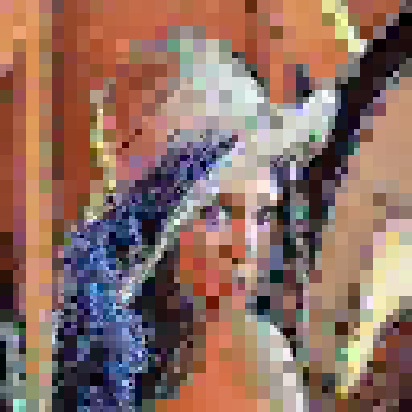
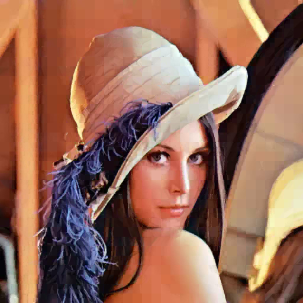

# Example: Lena

[Back to the README](../README.md)

## At 0.465 bpp

Encode and decode a 512×512 JPEG:

```bash
./target/release/encmars lena.jpg lena.mars   # 512x512 rgb (Yuv444) -> 15,234 bytes, 0.465 bpp
./target/release/decmars lena.mars decoded.png
```

| Original (`lena.jpg`, 512×512) | Decoded (`decoded.png`, 0.465 bpp) |
| --- | --- |
|  |  |

`marsbench` measures the reconstruction against the source JPEG: **29.87 dB PSNR-Y**,
0.811 SSIM, 0.960 MS-SSIM, from 15,234 bytes (0.465 bpp, header included). Decoding is
deterministic — a fresh decode reproduces `decoded.png` byte for byte.

## Progressive decode

`decmars` reconstructs the image by fixed-point iteration from a flat grey (128) seed.
`decmars lena.mars decoded.png --progression p/` writes `iter-01.png` … `iter-10.png`, one
per iteration. The first five, as the decode settles:

| iteration 1 | iteration 2 | iteration 3 | iteration 4 | iteration 5 |
| --- | --- | --- | --- | --- |
|  |  |  |  |  |

Iteration 10 is `decoded.png` above. `--iterations` sets a different fixed count;
`--auto --threshold N` instead stops early once no pixel moves by more than N between
iterations.
